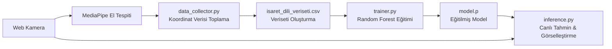

# 🖐️ Türk İşaret Dili (TİD) Tanıma ve Çeviri Sistemi

Bu proje, bilgisayarlı görü (Computer Vision) ve makine öğrenmesi (Machine Learning) yöntemleri kullanarak **Türk İşaret Dili** hareketlerini ve harflerini web kamerası üzerinden gerçek zamanlı olarak algılayan ve sınıflandıran bir Python uygulamasıdır.

Sistem, **Google MediaPipe** kütüphanesi ile el üzerindeki 21 eklem noktasının (landmarks) koordinatlarını tespit eder ve **Scikit-Learn (Random Forest Classifier)** modeli ile bu koordinatlara karşılık gelen harf veya kelimeleri tahmin eder.

---

## 📌 Proje Mimarisi ve İş Akışı

Sistem 4 temel aşamadan oluşur:



1. **El İskeleti Çıkarma:** MediaPipe eldeki 21 referans noktasının $x$ ve $y$ koordinatlarını (toplam 42 özellik) çıkarır.
2. **Veri Toplama:** Her işaret/harf sınıfı için koordinatlar etiketlenerek CSV formatında kaydedilir.
3. **Model Eğitimi:** Toplanan koordinat verileri Random Forest algoritmasıyla eğitilir ve `.p` dosyası olarak kaydedilir.
4. **Gerçek Zamanlı Çıkarım:** Canlı kamera akışında tespit edilen el koordinatları eğitilmiş modele verilerek anlık sınıf tahmini yapılır.

---

## 📂 Dizin Yapısı

```plaintext
tid_pyprj/
│
├── requirements.txt            # Proje bağımlılıkları listesi
├── README.md                   # Proje dokümantasyonu
│
└── tid_pyprj/
    ├── app.py                  # Gelecekteki ana uygulama / GUI arayüzü
    ├── data/                   # Veriseti dosyaları için klasör
    ├── models/                 # Eğitilmiş modeller için klasör
    └── src/
        ├── __init__.py         # MediaPipe el tespiti ve kamera test betiği
        ├── data_collector.py   # Kameradan veri toplama betiği
        ├── trainer.py          # Makine öğrenmesi modeli eğitim betiği
        └── inference.py        # Gerçek zamanlı işaret dili tanıma betiği
```

---

## 🛠️ Kullanılan Teknolojiler ve Kütüphaneler

- **Python 3.10+ / 3.11**
- **OpenCV (`opencv-python`):** Kamera akışını alma, görüntü işleme ve ekranda görselleştirme.
- **MediaPipe:** Gerçek zamanlı el eklem ve iskelet noktası (21 landmarks) tespiti.
- **Scikit-Learn (`scikit-learn`):** Veri ön işleme, `train_test_split`, `RandomForestClassifier` ve model değerlendirmesi.
- **Pandas & NumPy:** Sayısal veri işleme, CSV yönetimi ve matris operasyonları.
- **Pickle:** Eğitilen modelin diske kaydedilmesi ve yüklenmesi.

---

## 🚀 Kurulum

### 1. Depoyu İndirin ve Proje Dizinine Geçin
```bash
cd c:\Users\lenovo\Desktop\tid_pyprj\tid_pyprj
```

### 2. Sanal Ortam (Virtual Environment) Oluşturun ve Aktive Edin (Önerilen)
```powershell
python -m venv venv
.\venv\Scripts\Activate.ps1
```

### 3. Gerekli Kütüphaneleri Yükleyin
```bash
pip install -r requirements.txt
```

---

## 📖 Kullanım Kılavuzu

Proje adım adım aşağıdaki sırayla çalıştırılır:

### Adım 1: Kamera ve MediaPipe Testi
Kameranızın ve MediaPipe el takip modülünün doğru çalıştığını doğrulamak için:
```bash
python src/__init__.py
```
* **Çıkış:** `q` tuşuna basarak pencereyi kapatabilirsiniz.

---

### Adım 2: Veri Toplama (`data_collector.py`)
Kendi işaret dili veri setinizi oluşturmak için bu betiği çalıştırın:
```bash
python src/data_collector.py
```
1. Terminalde sizden kaydedilecek harf/sınıf istenir (örneğin: `A`, `B`, `Merhaba`).
2. Kamera açıldığında elinizi kameraya gösterin.
3. El işaretini yaparken **SPACE (Boşluk)** tuşuna basarak koordinatları kaydedin (her sınıf için en az 100-200 örnek önerilir).
4. Farklı açılardan ve mesafelerden çekim yapmak modelin başarısını artırır.
5. İlgili sınıfın kaydını bitirmek için **Q** tuşuna basın.
6. Başka bir harf/kelime için betiği tekrar çalıştırıp yeni etiketi girin.
* Toplanan veriler `isaret_dili_veriseti.csv` dosyasına yazılır.

---

### Adım 3: Model Eğitimi (`trainer.py`)
Topladığınız verilerle makine öğrenmesi modelini eğitmek için:
```bash
python src/trainer.py
```
- CSV dosyasındaki veriler okunur.
- %80 Eğitim, %20 Test olarak ayrılır.
- **Random Forest** algoritması ile model eğitilir ve test başarı oranı (accuracy) terminale yazdırılır.
- Eğitilen model `model.p` adıyla kaydedilir.

---

### Adım 4: Gerçek Zamanlı Tanıma (`inference.py`)
Eğitilen modeli canlı kamera akışında test etmek için:
```bash
python src/inference.py
```
- Kamera açılır ve elinizi gösterdiğinizde MediaPipe koordinatları modele iletir.
- Model tahmini elin üzerindeki kutu içerisinde eşzamanlı olarak gösterilir.
- **Çıkış:** `q` tuşuna basarak sonlandırabilirsiniz.

---

## 💡 İpuçları ve Gelecek Geliştirme Önerileri

- [ ] **Landmark Normalizasyonu:** Elin ekrandaki konumundan ve kameraya olan uzaklığından bağımsız olması için el bilek noktasına (wrist) göre bağıl koordinatlara çevirme (öklid / min-max normalizasyonu).
- [ ] **Kullanıcı Arayüzü (GUI / Web App):** Boş olan `app.py` dosyasına **Streamlit** veya **PyQt/Tkinter** tabanlı görsel bir arayüz eklenmesi.
- [ ] **Çift El Desteği:** İki el ile yapılan Türk İşaret Dili kelimeleri için her iki elin koordinatlarını kapsayan veri toplama yapısı.
- [ ] **Sesli Geri Bildirim (Text-to-Speech):** Algılanan harf ve kelimelerin sesli olarak telaffuz edilmesi (`pyttsx3` veya `gTTS`).
